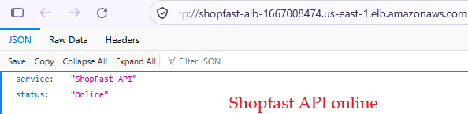
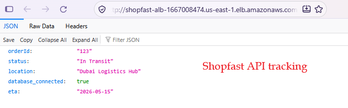
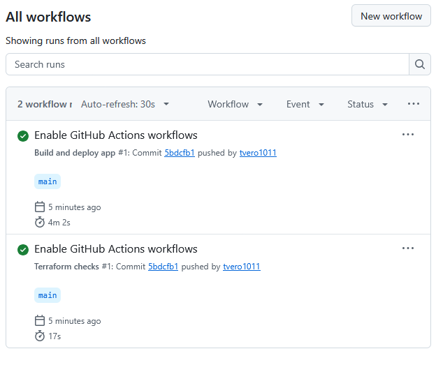
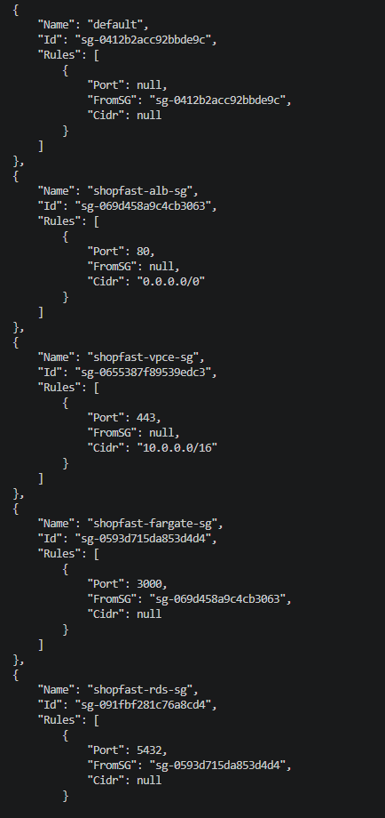

# ShopFast: Cloud-Native 3-Tier API on AWS (Terraform)

Infrastructure as Code for a containerized Node.js API on AWS. A public Application Load Balancer fronts ECS Fargate tasks running in private subnets, which talk to a private RDS PostgreSQL database. A GitHub Actions pipeline builds, pushes and deploys new versions using short-lived OIDC credentials.

> **Status:** DevOps portfolio and learning project. Deployed, tested and destroyed on AWS (us-east-1) on 17 and 18 October 2026; see [Deployment proof](#deployment-proof) and [Known limitations](#known-limitations-deliberate-scope-for-a-lab) before any production use.

## Architecture

```text
Internet ──HTTP:80──▶ ALB (public subnets, 2 AZs)
                       │ target group (type=ip, :3000, health check "/")
                       ▼
                      ECS Fargate tasks (private subnets, 2 AZs, autoscaling 2-4)
                       │ PostgreSQL :5432 (SSL)
                       ▼
                      RDS PostgreSQL (private subnets, encrypted)
```

Private subnets have no internet route. AWS services are reached through VPC endpoints:
S3 (gateway) and ecr.api, ecr.dkr, logs, secretsmanager (interface).

| Tier | Implementation |
| :--- | :--- |
| Public | Application Load Balancer, HTTP :80 |
| Application | ECS Fargate service, `assign_public_ip = false`, CPU-based autoscaling (min 2, max 4), deployment circuit breaker with automatic rollback |
| Data | RDS PostgreSQL 16, private, storage-encrypted, credentials generated by Terraform and stored in Secrets Manager |
| Network | Custom VPC, 2 public + 2 private subnets across 2 AZs, VPC endpoints instead of a NAT gateway |
| Registry | ECR with scan-on-push and a keep-last-5 lifecycle policy |
| CI/CD | GitHub Actions: build, push (commit-SHA tag), roll out new ECS task definition, wait for stability |

## Repository layout

```text
main.tf / variables.tf / outputs.tf / provider.tf / versions.tf   root module
modules/vpc            network, endpoints, security groups
modules/ecr            image registry
modules/rds            database + Secrets Manager
modules/alb            load balancer, target group, listener
modules/ecs            cluster, IAM, task definition, service, autoscaling
modules/github_oidc    IAM roles GitHub Actions assumes (OIDC, no stored keys)
modules/cloudwatch     SNS topic + alarms (ECS CPU, ALB 5xx/unhealthy, RDS CPU/storage)
bootstrap/             one-time: creates the S3 bucket used as the remote state backend
app/                   Node.js (Express 5 + pg) API, multi-stage Dockerfile
.github/workflows/     deploy.yml (app CI/CD), terraform-ci.yml (fmt + init + validate, no AWS credentials)
docs/proof/            deployment screenshots and captions
docs/scripts/          check-leftovers.ps1 (post-destroy check for billable leftovers)
```

## Key design decisions

- **Security group chaining:** internet → ALB SG (80) → Fargate SG (3000, ALB SG only) → RDS SG (5432, Fargate SG only). The Fargate SG lives in the VPC module and is used by both ECS and RDS, which also avoids a circular module dependency.
- **Secrets:** the DB password is generated by Terraform, stored in Secrets Manager and injected into the container at start. The execution role can read exactly one secret. The password is present in Terraform state, so state is kept remote, encrypted and locked (S3 native locking via `use_lockfile`, see `bootstrap/`) rather than as a local file.
- **No NAT gateway:** tasks reach ECR, S3, CloudWatch Logs and Secrets Manager via VPC endpoints, so private subnets have no internet path. For a small setup the interface endpoints cost about as much as a NAT gateway; the reason for choosing them is isolation.
- **Terraform vs pipeline ownership:** Terraform owns infrastructure; the pipeline owns which image runs. The service ignores `task_definition` and `desired_count` changes so `terraform apply` never undoes a deploy or autoscaling.
- **Shallow health check:** the ALB checks `/`, which does not touch the database, so a DB outage cannot cause every task to be marked unhealthy and restarted. The `alb-unhealthy-hosts` and `alb-5xx` CloudWatch alarms are the backstop that shallow check can't provide.
- **One OIDC role, and no AWS access on pull requests:** the deploy role can only be assumed by pushes to `main`, and can only push to one ECR repo and update one ECS service. Pull-request checks (`terraform fmt`, `init -backend=false`, `validate`) run with `contents: read` and no AWS credentials at all. See [Security review](#security-review-and-decisions) for why the PR plan role was removed.

## Deployment proof

The stack was deployed and tested on AWS (us-east-1) twice, and destroyed after each run:

- **17 October 2026:** the first version (53 resources, including a pull-request plan role that I later removed). The screenshots below come from this run.
- **18 October 2026:** the hardened version (49 resources) after the security review. It was verified with a green deploy run and a validate-only pull-request check, then destroyed and checked for leftovers (every count 0).

Account IDs are redacted. Every screenshot, with captions, is listed in [`docs/proof/captions.md`](docs/proof/captions.md).

**The API through the load balancer, with the database connected:**




**CI/CD: both workflows green, ECS running the commit-SHA image built by the pipeline:**



**Security: private encrypted database, no NAT gateway, chained security groups:**



The first version also ran `terraform plan` on pull requests with a read-only AWS role. After a security review I removed it (see [Security review](#security-review-and-decisions)); pull-request checks now run without any AWS access.

## Deploy (step by step)

This guide assumes you have never deployed this project before. Follow the steps in order and do not skip the checks. Each step says **where to run** the command, **what you should see**, and **what to do if you don't**.

> **Cost warning:** the load balancer, the database and the VPC endpoints are billed **every hour they exist**. Deploy, test, then destroy (Step 12) in the same sitting. Check the AWS Billing page the next day.

> **Where to run commands:** unless a step says otherwise, run commands from the **project root** (the folder that contains `main.tf`). Running Terraform from the wrong folder is the most common mistake. If a command says "No configuration files" you are in the wrong folder.

### Step 0. What you need installed

You need four tools. Check each one:

```bash
terraform version     # must be 1.10 or newer
aws --version         # AWS CLI
docker version        # must show both a Client and a Server section
git --version
```

If `docker version` shows an error under **Server**, start Docker Desktop and wait until it says it is running, then try again.

### Step 1. Get the code and open the project root

```bash
git clone https://github.com/<your-username>/<your-repo>.git
cd <your-repo>
```

You are in the project root when `dir` (PowerShell) or `ls` (Bash) shows `main.tf`, `modules`, `bootstrap` and `app`.

### Step 2. Log in to AWS and check who you are

Log in the way you normally do. If you use SSO (Identity Center):

```bash
aws sso login --profile YOUR_PROFILE
aws sts get-caller-identity --profile YOUR_PROFILE
```

**You should see:** a block with `UserId`, `Account` and `Arn`. That means you are logged in. Do not paste or screenshot this output anywhere public: it contains your account ID.

**If it fails:** the session expired or the profile name is wrong. Run the login command again.

### Step 3. Create the state bucket (first time only)

Terraform keeps a record of what it built (the **state**). This project stores it in an S3 bucket that lives outside the main project, so it survives `terraform destroy`.

**If you deployed before:** the bucket probably still exists. Check with:

```bash
aws s3 ls --profile YOUR_PROFILE
```

If you see your `shopfast-tfstate-...` bucket in the list, **skip to Step 4**.

**If this is your very first deploy:**

```bash
cd bootstrap
terraform init
terraform apply -var="state_bucket_name=shopfast-tfstate-<something-unique>"
```

Bucket names are unique across all of AWS, so make yours unique (for example add your initials and a number). Type `yes` when asked. When it finishes it prints the bucket name. Copy it into the `backend` block in `versions.tf` in the project root. Then go back:

```bash
cd ..
```

### Step 4. Create your settings file

```bash
cp terraform.tfvars.example terraform.tfvars
```

On PowerShell use `Copy-Item terraform.tfvars.example terraform.tfvars`.

Open `terraform.tfvars` in your editor and set:
- `github_repo`: your repo in the form `username/repo-name`
- `aws_profile`: your AWS profile name (for local runs)

This file is ignored by git on purpose. Never commit it.

### Step 5. Prepare Terraform

```bash
terraform fmt -recursive
terraform init
terraform validate
```

**You should see:** `Terraform has been successfully initialized!` after `init`, and `Success! The configuration is valid.` after `validate`.

**If `init` fails:** the bucket name in `versions.tf` is wrong, or the bucket does not exist, or you are not logged in (go back to Step 2).

### Step 6. Create the image registry first

The app needs a container image before the service can start, so create just the registry (ECR) first.

Bash:

```bash
terraform apply -target=module.ecr
```

PowerShell (the quotes are required, or PowerShell splits the text at the dot):

```powershell
terraform apply -target="module.ecr"
```

Read the plan, type `yes`. **You should see:** `Apply complete!` with a small number of resources added.

### Step 7. Build and push the first image

Make sure Docker Desktop is running.

**Bash:**

```bash
REPO=$(terraform output -raw ecr_repository_url)
REGISTRY=${REPO%%/*}
aws ecr get-login-password --region us-east-1 | docker login --username AWS --password-stdin $REGISTRY
docker build -t "$REPO:latest" ./app
docker push "$REPO:latest"
```

**PowerShell:**

```powershell
$repo = terraform output -raw ecr_repository_url
$registry = $repo.Split('/')[0]
# piping the token can fail with 400 Bad Request in PowerShell; use cmd for the login:
cmd /c "aws ecr get-login-password --region us-east-1 | docker login --username AWS --password-stdin $registry"
docker build -t "${repo}:latest" ./app
docker push "${repo}:latest"
```

**You should see:** `Login Succeeded`, then the build finishing, then layers being pushed.

**If login returns 400 Bad Request on PowerShell:** use the `cmd /c` line exactly as shown.

### Step 8. Build everything else

```bash
terraform apply
```

Terraform lists everything it will create. Read the summary line (`Plan: N to add, 0 to change, 0 to destroy`), type `yes`, and wait. The load balancer and the database take several minutes, so be patient and do not press Ctrl+C.

**You should see:** `Apply complete!` and a list of outputs, including `final_app_url`.

**If it fails partway:** do not run `terraform destroy` in a panic. Read the error text, find it under [Troubleshooting](#troubleshooting), fix it, and run `terraform apply` again. Terraform continues from where it stopped.

### Step 9. Add the GitHub repository variables

This lets the pipeline deploy to your new stack. In your GitHub repo go to **Settings → Secrets and variables → Actions → Variables** and add these **repository variables**, using the values from `terraform output`:

- `AWS_REGION`
- `ECR_REPOSITORY` (the name only, for example `shopfast-repo`, not the full URL)
- `ECS_CLUSTER`
- `ECS_SERVICE`
- `TASK_FAMILY`
- `AWS_ROLE_ARN`

The role ARN changes when the role is recreated, so after a redeploy always update `AWS_ROLE_ARN`.

From now on, pushing a change under `app/` to `main` deploys automatically, and opening a PR that touches `**.tf` runs format, init and validate checks (no AWS credentials).

Recommended: turn on branch protection for `main` requiring the `validate` check plus one review approval. Run `terraform plan` locally before every `terraform apply`; that local plan plus the review is the approval gate.

Optionally set `alert_email` in `terraform.tfvars` to get emailed when a CloudWatch alarm fires. Leave it unset to just create the SNS topic without a subscription.

### Step 10. Check that it works

```bash
terraform output final_app_url
```

Open that address in a browser.

1. **`/`** should return `{"service":"ShopFast API","status":"Online"}`. This proves the load balancer and the app work.
2. **`/track/123`** should return data with the database connected. This proves the app can reach the database.

If `/` works but `/track/123` fails with a 500 error, see Troubleshooting ("`/` returns 200 but `/track/123` returns 500").

Take your screenshots now, before you destroy anything. Crop out account IDs and hide ARNs.

### Step 11. Optional: prove the pipeline

Push a small change under `app/` to `main` and watch the **Actions** tab. A green run means the pipeline built an image, pushed it with the commit-SHA tag, rolled out a new task definition and waited for ECS to be stable.

### Step 12. Destroy everything (do not forget)

```bash
terraform destroy
```

Check the plan lists the resources being removed, type `yes`, and wait for `Destroy complete!`.

Then check for leftovers. In PowerShell, from the project root, run the check script. It prints one count per service, and every line should be `0`:

```powershell
cd <your-project-root>
Set-ExecutionPolicy -Scope Process -ExecutionPolicy Bypass   # this window only
Unblock-File .\docs\scripts\check-leftovers.ps1
.\docs\scripts\check-leftovers.ps1 -Profile YOUR_PROFILE
```

Two lines may show `1` and are fine: **secrets** (a deleted secret waits in a recovery window for a few days) and **OIDC providers** (if the account already had a GitHub OIDC provider before this project). The script is PowerShell only; on macOS or Linux, check the AWS console (us-east-1) for load balancers, RDS databases, VPC endpoints, NAT gateways, ECS clusters and log groups instead. The next day, check Billing and Cost Explorer.

The state bucket from `bootstrap/` is separate and is **not** destroyed by this command. That is intended. Tear it down manually only if you are done with the project for good: empty the bucket first (it is versioned, so remove all versions), then run `terraform destroy` inside `bootstrap/`.

**After a destroy:** the roles and cluster no longer exist, so the deploy workflow will fail by design until you deploy again. Disable it in the Actions tab (or redeploy) to keep the repo's checks green. The Terraform checks keep working because they use no AWS credentials.

### Quick redeploy (when you have done it before)

1. Login: `aws sso login --profile YOUR_PROFILE`, then check with `aws sts get-caller-identity`.
2. Start Docker Desktop.
3. Confirm the state bucket still exists (`aws s3 ls`).
4. `terraform init`, `terraform apply -target="module.ecr"`.
5. Login to ECR, `docker build`, `docker push` (Step 7).
6. `terraform apply`.
7. Update the GitHub variables, especially the role ARN.
8. Test `/` and `/track/123`.
9. `terraform destroy`.
10. Run `docs/scripts/check-leftovers.ps1` and confirm every line is `0`.

## Troubleshooting

- **Terraform checks fail on `fmt -check`:** run `terraform fmt -recursive` locally and commit the result.
- **Tasks keep restarting:** check the ECS service events and stopped-task reason, then the CloudWatch log group `/ecs/shopfast-api`.
- **Image pull timeout:** a VPC endpoint is missing (`ecr.api`, `ecr.dkr` or the S3 gateway), or the endpoint security group does not allow 443 from the VPC.
- **`/` returns 200 but `/track/123` returns 500:** the app cannot reach the database. Check that the RDS security group allows 5432 from the Fargate security group, then the logs for "Database query failed". The shallow health check hides this by design.
- **`terraform apply -target=module.ecr` fails on PowerShell:** quote the argument: `terraform apply -target="module.ecr"`.
- **ECR login returns 400 Bad Request on PowerShell:** run the login through `cmd /c` as shown above.
- **OIDC provider already exists:** set `create_github_oidc_provider = false`.
- **`terraform init` cannot find the state bucket:** the name in `versions.tf` does not match the bucket, or the bucket was deleted. Run `aws s3 ls` to check.
- **"No configuration files" error:** you are in the wrong folder. `cd` to the project root (the folder with `main.tf`).
- **Session expired mid-way:** run your login command again (Step 2), then repeat the same Terraform command.
- **PowerShell says the script "is not digitally signed":** run `Set-ExecutionPolicy -Scope Process -ExecutionPolicy Bypass` and `Unblock-File` on the script, as shown in Step 12. The setting only lasts for that PowerShell window.

## Security review and decisions

I reviewed this project for security issues, decided what to fix now, and wrote down the rest.

- **Fixed: no AWS access on pull requests.** An earlier version ran `terraform plan` on pull requests with a read-only AWS role. Read-only access can still read the Terraform state file, which holds the DB password, so any pull-request run that could assume the role could reach it. I removed the role. Pull-request checks now run only `fmt`, `init -backend=false` and `validate`, with `contents: read` and no credentials. I run `terraform plan` locally before every apply.
- **Accepted for the lab, documented: password in state.** Terraform generates the DB password, so it ends up in state. State is remote, encrypted and locked. The production fix is RDS-managed credentials, so the password never enters state.
- **Accepted for the lab, documented: HTTP only.** An ACM certificate needs a domain I own. For production: ACM certificate, HTTPS listener on 443, redirect 80 to 443.
- **Already in place:** least-privilege deploy role limited to one ECR repo and one ECS service, trusted only for pushes to `main`; no long-lived AWS keys (OIDC); private encrypted database; security groups chained so only the app reaches the database.

## Known limitations (deliberate scope for a lab)

- HTTP only (no domain/ACM certificate, so no HTTPS listener yet).
- RDS is single-AZ by default (`multi_az` variable available); `skip_final_snapshot` and 7-day log retention are lab settings.
- DB connection is encrypted but the RDS certificate is not verified (needs the RDS CA bundle in the image).
- No WAF yet.
- CloudWatch alarms cover CPU, 5xx, unhealthy hosts and DB storage, but there's no dashboard yet. Without `alert_email` the alarms have no subscribers.
- `terraform apply` and `terraform plan` run locally; there is no automated plan or apply in CI (on purpose: either would need AWS access from pull requests, or a much more privileged OIDC role).
- The DB password is stored in Terraform state. State is remote, encrypted and locked, but anyone who can read the state bucket can read the password. The production alternative is RDS-managed master credentials, so the password never enters state.
- ECR image tags are mutable (the pipeline also pushes `latest`); immutable tags with commit-SHA only would be stricter.
- No automatic secret rotation (RDS-managed master credentials with rotation is the production alternative).
- Modules are environment-agnostic (names, sizes and CIDRs are variables); separate per-environment `tfvars` and state are a next step.
- `/track/:orderId` returns hard-coded sample data after a real `SELECT NOW()` connectivity check.
